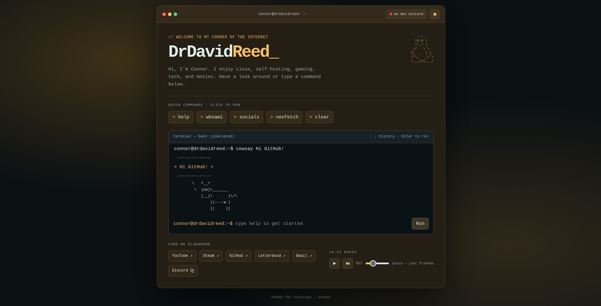

# DrDavidReed 🐧

A personal website inspired by the Linux terminal, built with HTML, CSS and JavaScript.

Rather than a traditional homepage, I wanted to create something interactive that reflects my interests in Linux, self-hosting, gaming, technology and movies.

**🌐 [Visit the live website](https://drdavidreed.github.io/drdavidreed-website/)**

## Preview



*A Linux-inspired personal homepage with an interactive terminal and customisable themes.*

## Features

- **Interactive Terminal** — A simulated Bash terminal with commands such as `help`, `whoami`, `neofetch`, `cowsay` and more.
- **Discord Rich Presence** — Displays my current Discord status and activity using the Lanyard API, with a popup showing additional details.
- **Customisable Themes** — Six colour themes, with preferences saved locally in the browser.
- **Lo-fi Music Player** — Built-in music controls with a small playlist.
- **Neofetch** — Displays my Bazzite Linux system specifications in a terminal-style layout.
- **Command History** — Navigate previously entered commands using the up and down arrow keys.
- **Responsive Design** — Designed for desktop and mobile browsers.
- **Easter Eggs** — A few hidden surprises for anyone experimenting with terminal commands.

## Available Themes

- Matrix Green
- Ocean Blue
- Cyber Purple
- Crimson Red
- Amber
- Monochrome

## Built With

- HTML5
- CSS3
- Vanilla JavaScript
- [Lanyard API](https://github.com/Phineas/lanyard) — Discord Rich Presence
- [GitHub Pages](https://pages.github.com/) — Website hosting

No frameworks or build tools required.

## Running Locally

Clone the repository:

```bash
git clone https://github.com/DrDavidReed/home.git
cd home
```

Start a local web server:

```bash
python3 -m http.server 8000
```

Open your browser and visit:

`http://localhost:8000`

The website can also be opened directly through `index.html`, although running a local server is recommended for consistent functionality.

## Hosting

The website is hosted using GitHub Pages and is available at:

**https://drdavidreed.github.io/home/**

## Notes

The terminal is simulated and does not execute real shell commands. All terminal interactions run locally in the browser.

Discord activity depends on the availability of the Lanyard API. Music playback requires the relevant audio files to be present.

## Contact

- [GitHub](https://github.com/DrDavidReed)
- [YouTube](https://www.youtube.com/@DrDavidReed)
- [Steam](https://steamcommunity.com/id/xDConnor/)
- [Letterboxd](https://letterboxd.com/DrDavidReed/)
- **Discord:** `drdavidreed`

---

Made by Connor.
